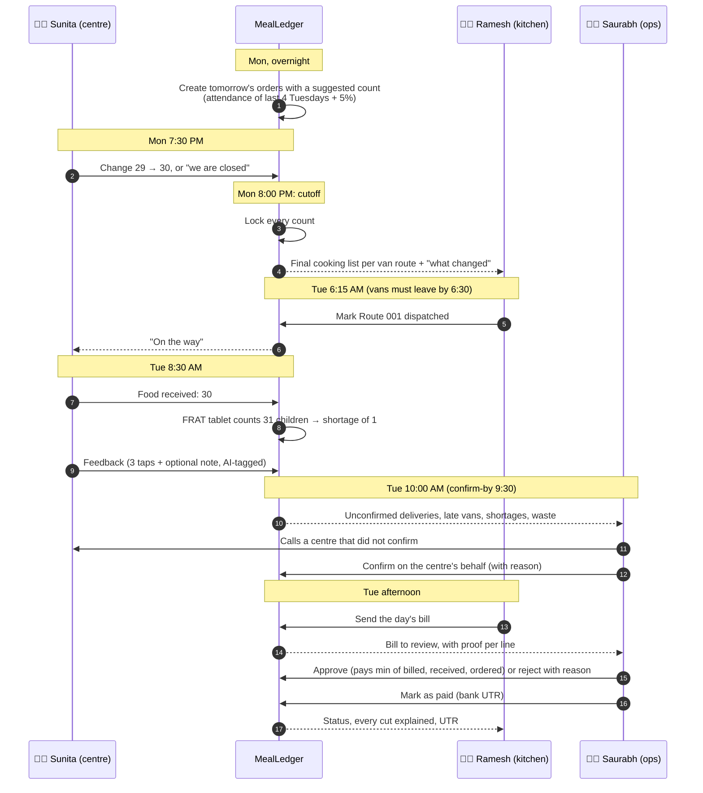
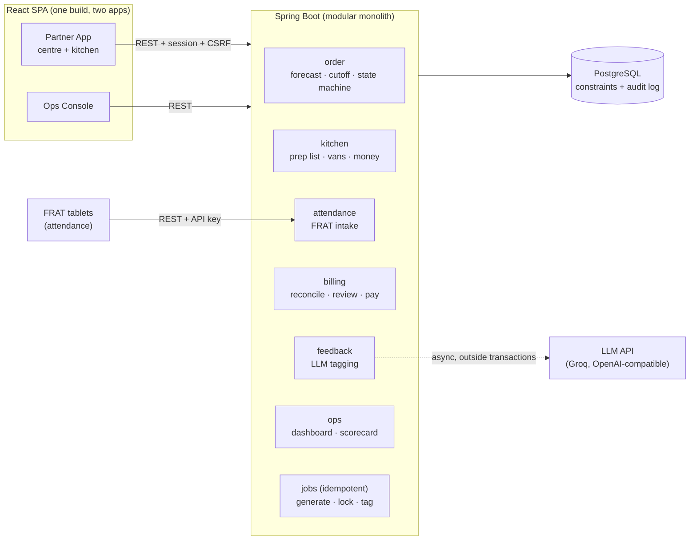
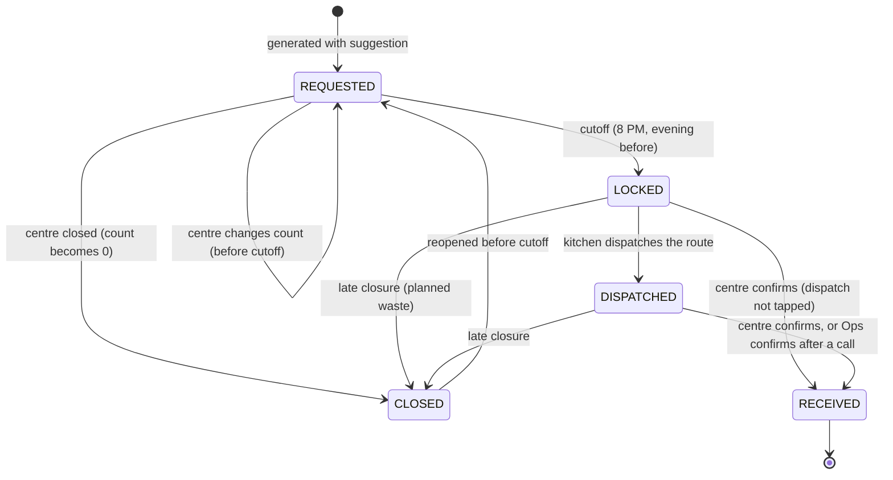
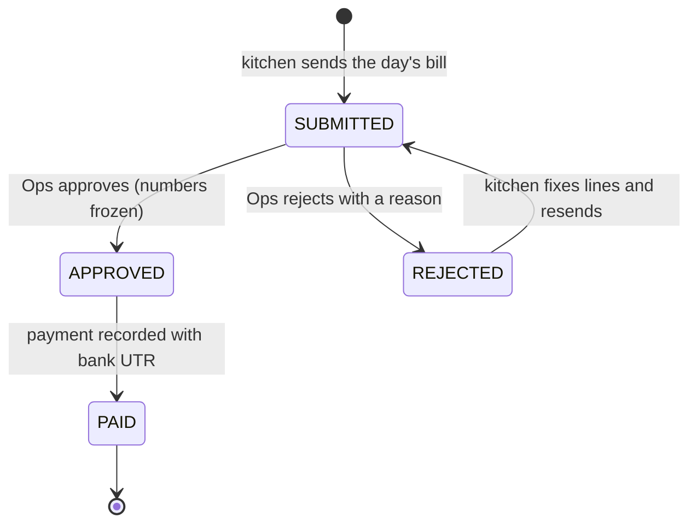
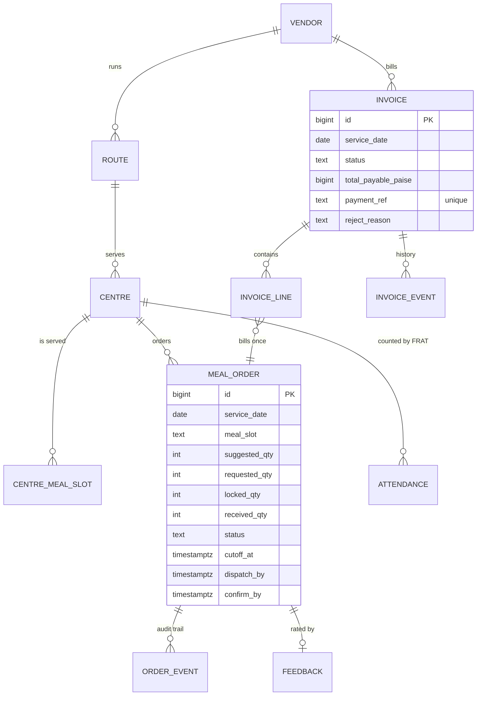

# MealLedger

**Daily meal operations for a school and Anganwadi feeding program: every child fed, every meal accounted for.**

MealLedger plans how many meals each centre needs from real attendance, locks the count for the kitchen at a cutoff, tracks every van to every centre, catches the centres that were missed, and pays kitchens only for what centres confirmed they received.

     

> Independent portfolio project, inspired by publicly available information about school-meal programs such as Feeding India (FY26 annual report, program pages, blog). It is not affiliated with Feeding India, Zomato or Eternal. Anything not public is marked **ASSUMPTION**.

---

## Contents

1. [The problem](#1-the-problem)
2. [One day, end to end](#2-one-day-end-to-end)
3. [What MealLedger does](#3-what-mealledger-does)
4. [Architecture](#4-architecture)
5. [Business rules](#5-business-rules)
6. [Data model](#6-data-model)
7. [API](#7-api)
8. [Requirements](#8-requirements)
9. [Scale and load test](#9-scale-and-load-test)
10. [Engineering decisions](#10-engineering-decisions)
11. [Run it](#11-run-it)
12. [Project structure](#12-project-structure)
13. [Known gaps and next steps](#13-known-gaps-and-next-steps)

---

## 1. The problem

About **1.7 lakh children** in **2,000+ schools and Anganwadis** get a free cooked meal every day. Central kitchens cook in the early morning and vans deliver route by route.

Three people make one meal happen:

| | Who | Uses | Does |
|---|---|---|---|
| 👩‍🏫 | **Sunita**, Anganwadi worker, Benipur (Varanasi) | Partner App | Tells tomorrow's count, confirms food arrived, gives feedback |
| 👨‍🍳 | **Ramesh**, central kitchen manager, Varanasi | Partner App | Cooks for 100 centres, sends 10 vans, bills the day |
| 🧑‍💻 | **Saurabh**, operations team, Gurugram | Ops Console | Watches all 2,000 centres, approves and pays bills |

Without a system, three things go wrong every day:

| Problem | What happens |
|---|---|
| 🗑️ **Food waste** | Kitchens cook for every enrolled child, even the ones who do not come that day |
| 🚫 **A centre gets missed** | A van never leaves, or nobody reports. Children go hungry and nobody notices |
| 💸 **Wrong bills** | A kitchen bills for more food than the centres actually received |

---

## 2. One day, end to end



---

## 3. What MealLedger does

| Problem | Feature | How it works |
|---|---|---|
| Food waste | **Attendance forecast** | Suggested count = average attendance on the last 4 same weekdays + 5% buffer. A worker can check it in her head, so she trusts it |
| Food waste | **8 PM cutoff lock** | Counts lock the evening before, so the kitchen cooks exactly the final number. Late closures are recorded as planned waste |
| Missed centres | **Van sheet + dispatch deadline** | Every route has stops, workers' phones and a leave-by time. Late or missing vans show up for Ops |
| Missed centres | **Unconfirmed deliveries** | Past the confirm-by time with no receipt → Ops sees "not dispatched" (call kitchen) or "not confirmed" (call centre) |
| Hungry children | **Shortage alert** | FRAT head count above meals received = a child may not have eaten. Highest-priority alert |
| Wrong bills | **Reconciliation + review** | Payable per line = `min(billed, received, ordered)`. Approve, or reject with a reason; kitchen fixes and resends; payment recorded with a UTR |
| Quality | **Feedback + AI tags** | Three taps after every meal plus a free-text note; an LLM labels notes (late, quality, hygiene…) for a weekly kitchen scorecard |

### Three apps, one source of truth

| App | User | Screens |
|---|---|---|
| **Partner App, centre** (phone) | Sunita | Tomorrow's count with the "why" chart · close for the day · food received · head count · feedback |
| **Partner App, kitchen** | Ramesh | Cooking plan + what changed · vans and stops (live) · reviews from centres · money preview, bill, bill history |
| **Ops Console** (laptop) | Saurabh | Today dashboard · late vans · shortages · waste trend · bills (review, approve / reject, pay, history) · kitchen scorecard · order audit trail |

All three read the same tables. A tap on Sunita's phone is the same row Ramesh's van sheet and Saurabh's dashboard read, so the apps never disagree.

---

## 4. Architecture



- **One deployable.** Spring Boot serves the React build from the same origin: one service to run, no CORS, simple session cookies.
- **Modular monolith.** Packages by business area (`order`, `kitchen`, `billing`…). At under 10 requests per second (section 9) microservices would add cost without benefit.
- **Plain SQL with `JdbcClient`.** Correctness lives in `WHERE` clauses and constraints, so the SQL stays visible.
- **Jobs are idempotent**, so they are safe to run late, twice, or on several instances, without a distributed lock.

### Order lifecycle



Status only moves forward. Every change writes an `order_event` row: who, when, how many, why.

### Bill lifecycle



---

## 5. Business rules

| Rule | Value | Why |
|---|---|---|
| Order key | centre + date + meal (breakfast / lunch) | Anganwadis get two meals a day |
| Suggested count | `ceil(avg(attendance, last 4 same weekdays) × 1.05)`; fallback: last locked count, then enrolment | Monday is not Saturday; the buffer means a shortage is less likely than a little waste |
| Cutoff | 8:00 PM the evening before (**ASSUMPTION**) | Central kitchens cook from early morning |
| Dispatch by | 6:30 AM breakfast, 11:00 AM lunch (**ASSUMPTION**) | Hot food has to arrive on time |
| Confirm by | 9:30 AM breakfast, 1:30 PM lunch (**ASSUMPTION**) | After this, a missing receipt is an alert |
| Typo guard | receipt above 120% of the locked count needs a second confirmation | Catches "700" for "70" |
| Payable per line | `min(billed, received, ordered)` | Never pay for food that was not received, or that nobody ordered |
| Late closure | kitchen paid for the locked count | The kitchen cooked in good faith; punishing it would make kitchens pad bills |
| Approval | blocked while any delivery is unconfirmed; Ops may confirm on a centre's behalf after a call, with a reason | We neither pay for what we cannot confirm, nor silently pay zero |
| Payment | one bank UTR settles one bill | Catches double payment |
| AI | labels text only, never counts or money | LLMs can be wrong; money follows fixed rules |

---

## 6. Data model



Rules the database itself enforces (it is the last guard even if code has a bug):

- `UNIQUE(centre_id, service_date, meal_slot)`: one order per centre per meal per day
- `UNIQUE(invoice_line.order_id)`: an order can be billed once, ever
- `UNIQUE(vendor_id, service_date)` on invoices; unique `payment_ref`
- `CHECK` constraints on statuses, non-negative counts, and required fields per status
- Money stored as integer **paise**, never floating point

Schema changes are versioned with Flyway (`backend/src/main/resources/db/migration`).

---

## 7. API

All endpoints return errors as RFC 9457 problems with a stable `code` (for example `CUTOFF_PASSED`, `UNCONFIRMED_DELIVERIES`). Every call is scoped to the logged-in user's centre or kitchen on the server.

**Auth**

| Method | Path | |
|---|---|---|
| POST | `/api/auth/login` | Phone + password, starts a session |
| GET | `/api/auth/me` | Current user (also sets the CSRF cookie) |
| POST | `/api/auth/logout` | |

**Partner App: centre**

| Method | Path | |
|---|---|---|
| GET | `/api/centre/orders` | Today's and next day's meals, with suggestion and basis |
| PUT | `/api/centre/orders/{id}` | Change tomorrow's count (before cutoff) |
| POST | `/api/centre/orders/{id}/close` | Closed for the day, with reason |
| POST | `/api/centre/orders/{id}/receive` | Food received (safe to repeat) |
| POST | `/api/centre/orders/{id}/attendance` | Manual head count where FRAT is not used |
| POST | `/api/centre/orders/{id}/feedback` | Three taps + optional note |

**Partner App: kitchen**

| Method | Path | |
|---|---|---|
| GET | `/api/kitchen/prep-list?date=` | Cooking list and van runs with stops, deadlines and live status |
| GET | `/api/kitchen/changes?date=` | What centres changed, from the audit log |
| POST | `/api/kitchen/routes/{id}/dispatch` | Van left (safe to repeat) |
| GET | `/api/kitchen/reviews?date=` | Centre feedback per day + notes with AI tags |
| GET | `/api/kitchen/money?date=` | Payment preview: confirmed, pending, who to call |
| GET | `/api/kitchen/invoice-draft?date=` | Lines to bill |
| POST | `/api/kitchen/invoices` | Send the day's bill |
| GET | `/api/kitchen/invoices` · `/{id}` | My bills (30 days), status, cuts, UTR |
| POST | `/api/kitchen/invoices/{id}/resubmit` | Fix and resend a rejected bill |

**Ops Console**

| Method | Path | |
|---|---|---|
| GET | `/api/ops/dashboard?date=` | Stages, unconfirmed, shortages, waste, late vans, next day |
| GET | `/api/ops/orders/{id}` | One meal end to end with its audit trail |
| PUT | `/api/ops/orders/{id}/override` | Change a locked count (before dispatch, with reason) |
| PUT | `/api/ops/orders/{id}/confirm` | Confirm receipt for a silent centre after a call |
| GET | `/api/ops/invoices?from=&to=` | Bills and payment history |
| GET | `/api/ops/invoices/{id}` | Lines with reconciliation and proof |
| POST | `/api/ops/invoices/{id}/approve` · `/reject` · `/pay` | Review decisions and payment |
| GET | `/api/ops/scorecard?date=` | Kitchens: vans on time (facts) + centre ratings (opinions) |

**Integration**

| Method | Path | |
|---|---|---|
| POST | `/api/integrations/frat/attendance` | Batch of head counts from FRAT (API key, idempotent upsert, per-entry validation) |

---

## 8. Requirements

### Functional

1. Generate one order per centre per meal per operating day, with a suggested count and its reason.
2. Centres can change a count or close until the cutoff; after it, counts are final.
3. Kitchens see final counts per van route, every change with who and when, and dispatch routes.
4. Centres confirm receipt; FRAT or a manual count records children present.
5. Ops sees unconfirmed deliveries, late vans, shortages and waste for any day, and the full history of any order.
6. Kitchens bill per day; Ops approves or rejects with a reason; kitchens resend; payments are recorded with a bank reference.
7. Centres rate every meal; notes are tagged by an LLM into a weekly kitchen scorecard.

### Non-functional

| Need | How it is met |
|---|---|
| **Correctness under concurrency** | Row locks, conditional updates, forward-only states; tested with racing threads |
| **Safe retries** (bad village network) | Receipt and dispatch are set operations, not increments; FRAT upserts ignore exact resends |
| **Auditability** | Every order change and every bill step is an event row |
| **Money accuracy** | Integer paise, one pure billing function, numbers frozen at approval |
| **Time correctness** | Database in UTC, business rules in India time, an injectable clock |
| **Graceful degradation** | If the LLM is down, feedback is saved untagged and retried; nothing else is affected |
| **Security** | Session login, CSRF protection, role checks per URL, data scoped by the session (another centre's order looks like "not found"), constant-time API-key check |
| **Performance** | Peak load under 10 req/s; see section 9 |

---

## 9. Scale and load test

The program serves about **1.5 lakh meals a day**, but the system's unit of work is an **order** (one centre, one meal), not a meal:

| | Per day | Peak |
|---|---|---|
| Orders | ~2,850 (1,150 schools × 1 + 850 Anganwadis × 2) | — |
| Count edits before cutoff | ≤ 2,850 | ~3 req/s if all come in the last 15 minutes |
| Receipts | ~2,850 | ~1 req/s per meal window |
| FRAT counts | ~2,850 (one per centre per meal, not per child) | — |
| Ops dashboard polling | — | ~5 req/s (50 people) |

So the real peak is **under 10 requests per second**. A single app instance and one Postgres handle it with a wide margin.

**Measured** on one 8 GB laptop (app, Postgres, Docker and k6 on the same machine), with 2,000 centres and 4 weeks of history:

| Test | Result |
|---|---|
| Normal peak, ~18 req/s for 60 s (k6) | **0 errors**; count edit p95 **49 ms**; reads p95 **27 ms** |
| 10× growth, ~160 req/s for 60 s (k6) | **0 errors** in 9,734 requests; median 15–37 ms; p95 ~1 s (laptop CPU and RAM limit) |
| Lock 30,000 orders at once (10× the cutoff) | **2.6 s**, one set-based `UPDATE`; a second run changes 0 rows |
| Ops dashboard cache | p95 360 ms → 27 ms: computed once per change or 10 s, shared by all Ops users |

**How it scales further:** a read replica for dashboards; partition `meal_order` by month (about 1 million rows a year); move the in-process change counter to Postgres `LISTEN/NOTIFY` or Redis when there are several app servers; sessions in the database (Spring Session JDBC).

---

## 10. Engineering decisions

| Decision | Why |
|---|---|
| **Deadlines are data, not timers.** `cutoff_at`, `dispatch_by`, `confirm_by` are stored on every order | "Late" and "locked" become simple queries; jobs can run at any time; rules can change without rewriting history |
| **Read the clock after taking the row lock** | A request that waited behind the 8 PM lock sees the real time, so an edit can never land after the lock |
| **Lock-on-touch + sweeper** | A centre acting a second after cutoff is handled correctly even if the background job has not run yet |
| **Idempotent jobs instead of distributed locks** | `UPDATE … WHERE status = 'REQUESTED'` finds nothing the second time |
| **One audit log, many uses** | Ops history, the kitchen's "what changed", proof on bills, dispute evidence |
| **One billing function** | The kitchen's money preview and Ops approval run the same `Reconciler`, so they never disagree |
| **Facts vs opinions** | "Vans on time" comes from timestamps; ratings come from centres; the scorecard shows both |
| **LLM outside transactions** | No database connection is held while waiting on the network; LLM output is validated against a fixed tag list (prompt-injection safe) |
| **Simple forecast, not ML** | An average a worker can verify beats a model nobody trusts |

---

## 11. Run it

**Requirements:** Docker. For local development also Java 21 and Node 22.

```bash
# everything in containers (demo data is seeded on first start)
cp .env.example .env          # optional: add GROQ_API_KEY for AI tags
docker compose up --build
# open http://localhost:8080  (all demo users: password demo1234)
```

Local development:

```bash
docker compose up -d db                                   # Postgres on :5433
cd backend && ./mvnw spring-boot:run -Dspring-boot.run.profiles=demo -Dspring-boot.run.jvmArguments=-Duser.timezone=UTC
cd frontend && npm install && npm run dev                 # http://localhost:5173
```

**Demo.** The app opens on a story page. The demo panel (bottom right) has two modes:

- **📖 Guided story:** eight steps through one service day. Each step moves the clock, signs in as the right person and highlights the button to press.
- **🎛️ Free demo:** be anyone, set any time of the day, and run the other 1,999 centres and 19 kitchens.

| Demo user | Phone |
|---|---|
| Sunita, Anganwadi Benipur-01 | 9000000001 |
| Ramesh, Central Kitchen Varanasi-1 | 8000000001 |
| Saurabh, Ops team | 9999999999 |

**Tests** (real Postgres through Testcontainers): cutoff race, 20 parallel identical receipts, forecast maths, billing and payment rules, bill reject and resend, security over HTTP, and the 30,000-order lock.

```bash
cd backend && ./mvnw test
GROQ_API_KEY=... ./mvnw test -Dtest=FeedbackTaggerEval    # LLM tagging accuracy on 30 labelled notes
```

**Load test:**

```bash
docker compose --profile loadtest run --rm k6 run /scripts/peak.js             # normal peak
docker compose --profile loadtest run --rm -e RATE=100 k6 run /scripts/peak.js # 10x
```

---

## 12. Project structure

```
backend/src/main/java/com/mealledger/
  order/        orders, forecast, cutoff, state machine, centre API
  kitchen/      prep list, van runs, changes, money preview, kitchen API
  attendance/   FRAT intake and manual counts
  billing/      Reconciler (billing rule), bills: submit, review, pay
  feedback/     feedback, LLM tagger, tag parser
  ops/          dashboard, order timeline, scorecard, Ops API
  demo/         seed data, simulator, clock control (demo profile only)
  config/       security, clock, scheduling, jobs
backend/src/main/resources/db/migration/   Flyway schema (V1–V4)
frontend/src/
  pages/partner/   centre and kitchen screens
  pages/ops/       Ops Console
  story.ts, tour.tsx, DemoBar.tsx   guided story and free demo
loadtest/peak.js   k6 scenarios
```

---

## 13. Known gaps and next steps

| Gap | Next step |
|---|---|
| Public holiday for a whole district | Ops "bulk close" |
| One Ops user can both approve and pay | Maker-checker for large amounts |
| Sessions live in app memory | Spring Session JDBC for several servers |
| Alerts only on screens | SMS / WhatsApp for late vans and missing confirmations |
| No offline mode | Queue actions on the phone; retries are already safe |
| No kitchen dispute of a centre's count | A dispute flow with evidence |
| Fixed routes | Route planning from geography and van capacity |
